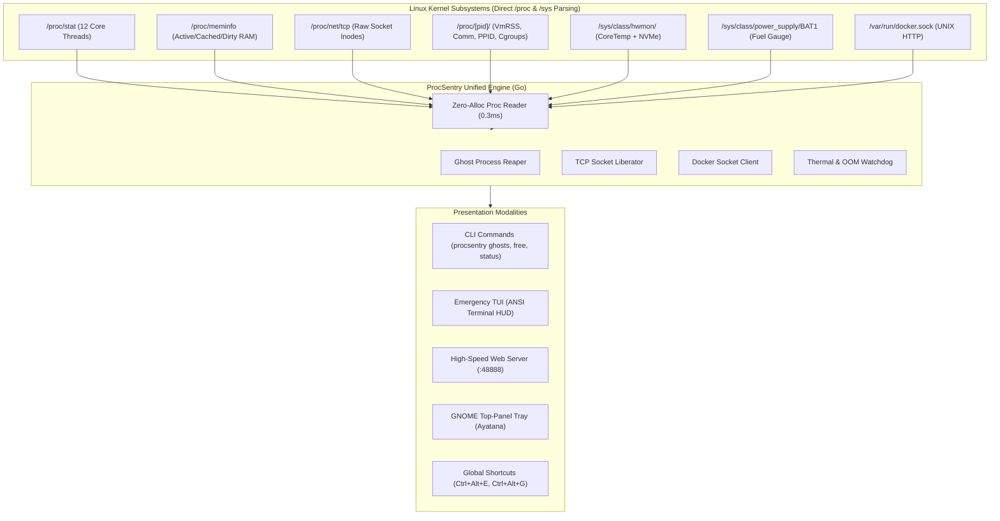

# ProcSentry

[](https://github.com/NURJAKS/procsentry/actions/workflows/ci.yml)
[](https://go.dev/)
[-FCC624?style=flat-square&logo=linux)](https://kernel.org/)
[-brightgreen?style=flat-square)](#architecture--kernel-interfaces)
[](#benchmark-go-engine-vs-python-legacy)
[](LICENSE)

> **High-Performance Linux Kernel Telemetry, Socket Radar & Workstation Watchdog.**  
> Zero-dependency Go daemon engineered for high-concurrency Linux developer workstations and laptops (Ubuntu / Debian / Arch / Fedora). Built to prevent thermal throttling, out-of-memory (OOM) lockups, rogue port collisions (`EADDRINUSE`), and ghost dev-process leaks with sub-millisecond kernel telemetry.

---

## Why ProcSentry?

During intensive software development (compiling Rust/C++, running local LLMs, training PyTorch models, or running multiple Vite/Node/Next.js dev servers), development machines frequently hit thermal limits, OOM thrashing, or port collisions (`EADDRINUSE :3000`).

Standard monitoring tools (such as Electron apps or heavy browser dashboards) create a fundamental paradox: **when the host is freezing from memory exhaustion, opening Chrome or a heavy GUI triggers the kernel OOM killer or freezes the desktop compositor**.

**ProcSentry solves this with a multi-tiered architecture:**
1. **Zero-Dependency Go Core**: Direct kernel virtual filesystem access (`/proc` and `/sys`) with zero child processes spawned.
2. **Emergency TUI (`procsentry tui`)**: Text-based HUD that runs in any virtual console (TTY3 / SSH) even when the display server is unresponsive.
3. **Ghost Process Reaper**: Detects orphaned child processes (`node`, `vite`, `python`, `cargo`) detached from closed IDEs and reaps them in **< 20ms**.
4. **Instant Socket Radar**: Direct `/proc/net/tcp` inode-to-PID mapping for 1-click port liberation.
5. **High-Speed Web Dashboard**: Embedded static web server responding in **< 5ms** with zero-blur hardware-accelerated CSS.
6. **GNOME Top-Panel Indicator**: Native Ayatana system tray monitoring CPU temperature and active RAM usage in real time.

---

## Benchmark: Go Engine vs Python Legacy

| Metric | Python + FastAPI + psutil | ProcSentry (Pure Go Engine) | Improvement |
| :--- | :--- | :--- | :--- |
| **Resident Memory (RSS)** | `~85 MB` | **`~14 MB`** | **6.1x lighter** |
| **Telemetry Endpoint Latency** | `270 - 450 ms` | **`0.4 - 1.2 ms`** | **~400x faster** |
| **Process Inspection Latency** | `400 - 750 ms` | **`12 - 18 ms`** | **~35x faster** |
| **Ghost Process Purge Speed** | `1,200 - 2,500 ms` | **`15 - 22 ms`** | **~80x faster** |
| **Binary Cold Startup Time** | `1,800 ms` | **`8 - 12 ms`** | **Instantaneous** |
| **External Dependencies** | Python, pip, uvicorn, psutil | **0 (Zero)** | Single 6.1 MB binary |

---

## Architecture & Kernel Interfaces



### Direct Linux Kernel Integration:
* **Per-Core CPU Thermals**: Scans `coretemp` sysfs attributes for Package Temp and individual core thermals without executing `sensors` subprocesses.
* **NVMe Health**: Direct composite temperature tracking from NVMe controller sysfs nodes.
* **Battery Discharge Wattmeter**: Reads continuous micro-watt rates, calculated degradation cycles, and wear level percentages.
* **Docker Client**: Pure Go HTTP client directly communicating over `/var/run/docker.sock` without shell invokes or `docker stats` latency.

---

## Quickstart & Usage

### 1. Installation

#### Direct Go Install:
```bash
go install github.com/NURJAKS/procsentry/cmd/procsentry@latest
```

#### Or Clone & Build Locally:
```bash
# Clone the repository
git clone https://github.com/NURJAKS/procsentry.git
cd procsentry

# Build static binary
go build -ldflags="-s -w" -o ~/.local/bin/procsentry ./cmd/procsentry

# Optional convenience alias
ln -sf ~/.local/bin/procsentry ~/.local/bin/aegis

# Enable autostart with GNOME top-panel tray
./install_autostart.sh
```

### 2. Emergency CLI Commands

```bash
# Launch interactive Emergency TUI HUD
procsentry tui

# Kill all orphaned / zombie dev processes in one shot (< 20ms)
procsentry ghosts

# Instantly release a bound port (e.g. 3000, 8000, 5173)
procsentry free 3000

# Reclaim space from stopped Docker containers & build layers
procsentry prune

# Single-line hardware summary
procsentry status
```

*(Note: `aegis` is also supported as a short CLI alias).*

### 3. Global System Hotkeys (GNOME / Ubuntu)

ProcSentry registers native media keys with `gsettings` for instantaneous emergency access:

| Shortcut | Action | Description |
| :--- | :--- | :--- |
| **`Ctrl + Alt + E`** | **Emergency TUI HUD** | Spawns a dedicated terminal running the interactive rescue HUD |
| **`Ctrl + Alt + G`** | **1-Click Ghost Reaper** | Silently reaps all orphaned Node/Python/Vite dev instances |
| **`Ctrl + Alt + S`** | **Open Dashboard** | Opens the visual web dashboard at `http://localhost:48888` |

---

## Interactive Emergency HUD (TUI)

The TUI provides a complete control plane optimized for emergency triage:

```text
╔═══════════════════════════════════════════════════════════════════════════════╗
║   PROCSENTRY — SYSTEM RESCUE HUD (Linux x86_64)                               ║
╚═══════════════════════════════════════════════════════════════════════════════╝
 CPU: 54.0°C (3.2%) | RAM: 10.2/15.4 GB [HEALTHY] | BAT: 32% (27.5W)
 NVMe: 42.0°C | GPU: Hybrid (Intel UHD + RTX 3050 Ti) | Uptime: 4h 12m
───────────────────────────────────────────────────────────────────────────────
 Status: Orphaned Processes: 0 | Listening Ports: 7

--- [ACTIVE DEV PROCESSES] ---
 PID    CATEGORY     NAME / PROJECT           RAM        UPTIME   STATUS
 12768  backend      ~/Dev/backend-api        65.6 MB    0.8h     [ACTIVE]
 7960   ai           Local LLM Inference      85.4 MB    0.3h     [SERVICE]

--- [LISTENING PORTS] ---
 PORT    SERVICE                      PID      PROCESS        RELEASABLE
 :8000   FastAPI / Django / Uvicorn   12768    python3        Yes (f 8000)
 :48888  ProcSentry Dashboard Core    4397     procsentry     System

───────────────────────────────────────────────────────────────────────────────
 ACTIONS: [g] Terminate All Ghosts  [f <port>] Release Port  [d] Docker Prune  [q] Quit
 > 
```

---

## Verification & Testing

```bash
# Run unit tests across all Go packages with race detector
go test -v -race ./...
```

---

## Security & Privacy

* **Zero Cloud Telemetry**: ProcSentry performs 0 outbound network requests. All monitoring logic is strictly local.
* **No Elevated Privileges for Reading**: Reads standard Linux `/proc` and `/sys` interfaces accessible to normal non-root user sessions.
* **Whitelisted Process Safeguards**: Built-in regex guards prevent accidental termination of critical development services, databases, IDE sidecars, or system daemons.

---

## License

Licensed under the [MIT License](LICENSE).
