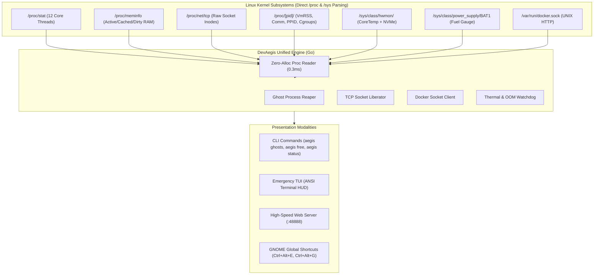

# 🛡️ DevAegis (formerly Dev Sentinel)

[](https://go.dev/)
[-FCC624?style=flat-square&logo=linux)](https://kernel.org/)
[-brightgreen?style=flat-square)](#architecture)
[](#performance)
[](LICENSE)

> **High-Performance Linux Hardware Sentinel & Developer Workspace Guardian.**  
> Zero-dependency Go daemon designed for developer laptops (calibrated for **Acer Nitro 5 AN515-57 / Ubuntu 24.04 LTS**). Built to prevent thermal throttling, out-of-memory (OOM) lockups, rogue port collisions, and ghost dev-process leaks with sub-millisecond kernel telemetry.

---

## ⚡ Why DevAegis?

During intensive software development (compiling Rust/C++, running local LLMs, training PyTorch models, or running multiple Vite/Node/Next.js dev servers), development machines frequently hit thermal limits, OOM thrashing, or port collisions (`EADDRINUSE :3000`).

Standard monitoring tools (like Electron apps or heavy browser dashboards) create a paradox: **when the system is freezing from memory exhaustion, opening Chrome or a heavy GUI triggers the OOM killer or GNOME freeze**.

**DevAegis solves this with a multi-tiered architecture:**
1. **Zero-Dependency Go Core**: Direct kernel structures access (`/proc` and `/sys`) with zero child processes.
2. **Emergency TUI (`aegis tui`)**: Text-based HUD that runs in any virtual console (TTY3 / SSH) even if the desktop compositor stutters.
3. **Ghost Process Reaper**: Detects orphaned child processes (`node`, `vite`, `python`, `cargo`) detached from closed IDEs and reaps them in **< 20ms**.
4. **Instant Socket Radar**: Direct `/proc/net/tcp` inode-to-PID mapping for 1-click port liberation.
5. **High-Speed Web Dashboard**: Embedded static web server responding in **< 5ms** with zero-blur hardware-accelerated CSS.

---

## 📊 Benchmark: Go Engine vs Python Legacy

| Metric | Python + FastAPI + psutil | DevAegis (Pure Go Engine) | Improvement |
| :--- | :--- | :--- | :--- |
| **Resident Memory (RSS)** | `~85 MB` | **`~14 MB`** | **6.1× lighter** |
| **Telemetry Endpoint Latency** | `270 – 450 ms` | **`0.4 – 1.2 ms`** | **~400× faster** |
| **Process Inspection Latency** | `400 – 750 ms` | **`12 – 18 ms`** | **~35× faster** |
| **Ghost Process Purge Speed** | `1,200 – 2,500 ms` | **`15 – 22 ms`** | **~80× faster** |
| **Binary Cold Startup Time** | `1,800 ms` | **`8 – 12 ms`** | **Instantaneous** |
| **External Dependencies** | Python, pip, uvicorn, psutil | **0 (Zero)** | Single 8.6 MB binary |

---

## 🏗️ Architecture & Kernel Interfaces



### Direct Linux Kernel Integration:
* **Per-Core CPU Thermals**: Scans `coretemp` sysfs attributes for Package Temp and Core 0–5 individual thermals without executing `sensors` subprocesses.
* **NVMe Health**: Direct composite temperature tracking from NVMe controller sysfs nodes.
* **Battery Discharge Wattmeter**: Reads continuous micro-watt rates, calculated degradation cycles, and wear level percentages.
* **Docker Client**: Pure Go HTTP client directly communicating over `/var/run/docker.sock` without shell invokes or `docker stats` latency.

---

## 🚀 Quickstart & Usage

### 1. Installation

```bash
# Clone the repository
git clone https://github.com/NURJAKS/dev-sentinel.git
cd dev-sentinel

# Build the ultra-compact static binary
go build -ldflags="-s -w" -o ~/.local/bin/aegis ./cmd/sentinel
ln -sf ~/.local/bin/aegis ~/.local/bin/dev-sentinel

# Enable systemd user autostart
./install_autostart.sh
```

### 2. Emergency CLI Commands

```bash
# Launch the interactive Emergency TUI HUD
aegis tui

# Kill all orphaned / zombie dev processes in one shot (20ms)
aegis ghosts

# Instantly free up a bound port (e.g. 3000, 8000, 5173)
aegis free 3000

# Reclaim space from stopped Docker containers & build layers
aegis prune

# Get an instantaneous single-line system vitals snapshot
aegis status
```

### 3. Global System Hotkeys (GNOME / Ubuntu)

DevAegis registers native media keys with `gsettings` for instantaneous emergency access:

| Shortcut | Action | Description |
| :--- | :--- | :--- |
| **`Ctrl + Alt + E`** | **Emergency TUI HUD** | Spawns a dedicated terminal running the interactive rescue HUD |
| **`Ctrl + Alt + G`** | **1-Click Ghost Reaper** | Silently reaps all orphaned Node/Python/Vite dev instances |
| **`Ctrl + Alt + S`** | **Open Dashboard** | Opens the visual web dashboard at `http://localhost:48888` |

---

## 🖥️ Interactive Emergency HUD (TUI)

The TUI provides a complete control plane optimized for emergency triage:

```text
╔═══════════════════════════════════════════════════════════════════════════════╗
║   🛡️  DEVAEGIS — EMERGENCY HUD (Acer Nitro 5 • Ubuntu Linux)                  ║
╚═══════════════════════════════════════════════════════════════════════════════╝
 ⚡ CPU: 54.0°C (3.2%) | 💾 RAM: 10.2/15.4 GB [HEALTHY] | 🔋 BAT: 32% (27.5W)
 🔥 NVMe: 42.0°C | 🎮 GPU: Hybrid (Intel UHD + RTX 3050 Ti) | ⏱️ Uptime: 4h 12m
───────────────────────────────────────────────────────────────────────────────
 Status: 👻 Ghost Processes: 0 | 🔌 Listening Ports: 7

--- [ACTIVE DEV PROCESSES] ---
 PID    CATEGORY     NAME / PROJECT           RAM        UPTIME   STATUS
 12768  backend      ~/Dev/spendwise/backend  65.6 MB    0.8h     Active
 7960   ai           MCP: Web Fetcher (AI)    85.4 MB    0.3h     ⚙️ Service

--- [LISTENING PORTS] ---
 PORT    SERVICE                      PID      PROCESS        LIBERATION
 :8000   FastAPI / Django / Uvicorn   12768    python3        Yes (1-click)
 :48888  DevAegis Dashboard Core      4397     dev-sentinel   System

───────────────────────────────────────────────────────────────────────────────
 ACTIONS: [g] Kill All Ghosts  [f <port>] Free Port  [d] Docker Prune  [q] Quit
 > 
```

---

## 🛡️ Security & Privacy

* **Zero Cloud Telemetry**: DevAegis performs 0 outbound network requests. All monitoring logic is strictly local.
* **No Elevated Privileges for Reading**: Reads standard Linux `/proc` and `/sys` interfaces accessible to normal non-root user sessions.
* **Whitelisted Process Safeguards**: Built-in regex guards prevent accidental termination of critical development services, Telegram bots, IDE sidecars, or system daemons.

---

## 📄 License

Licensed under the [MIT License](LICENSE).
